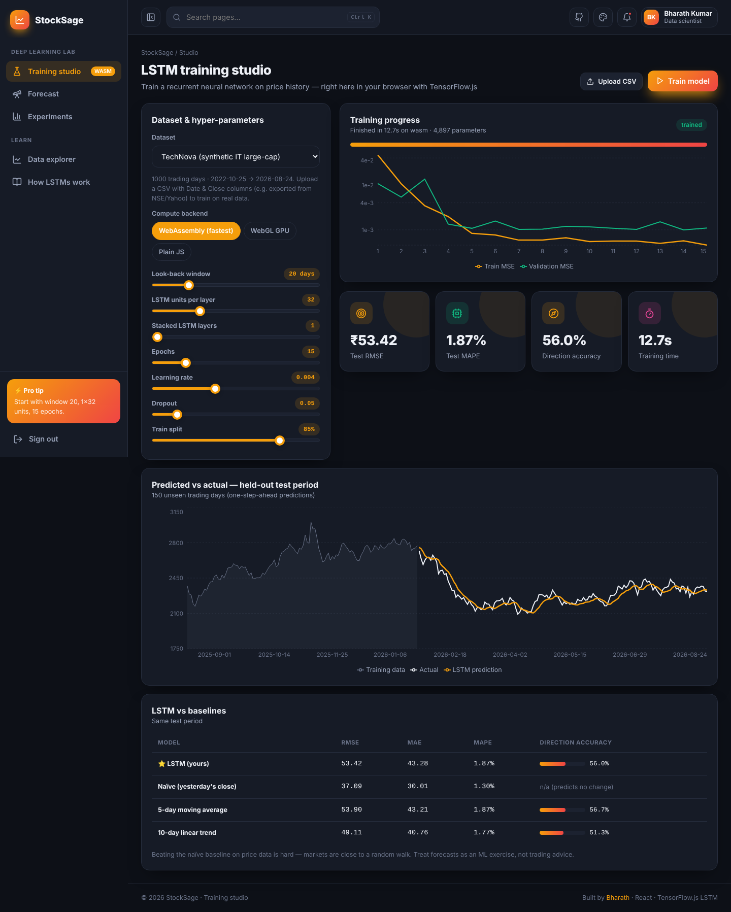
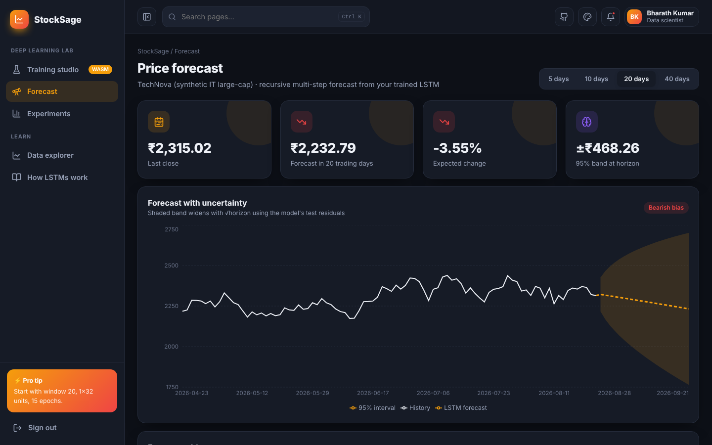
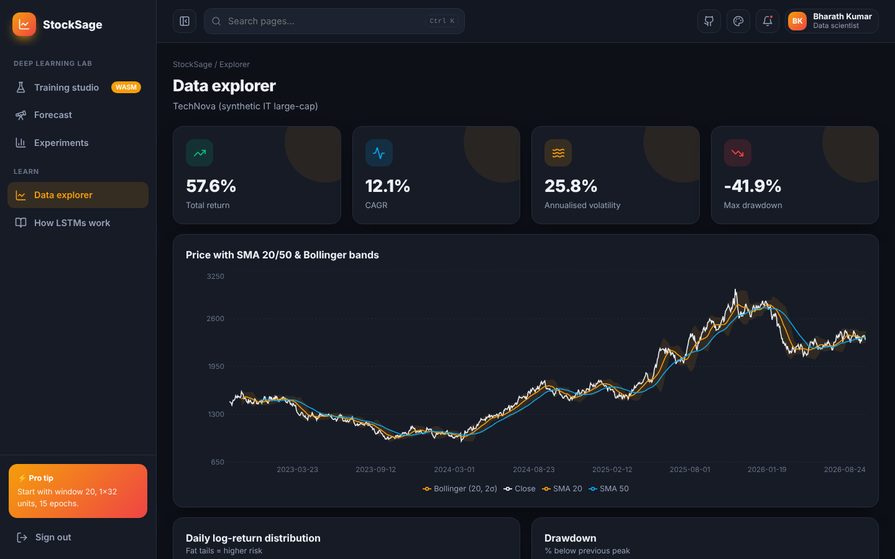
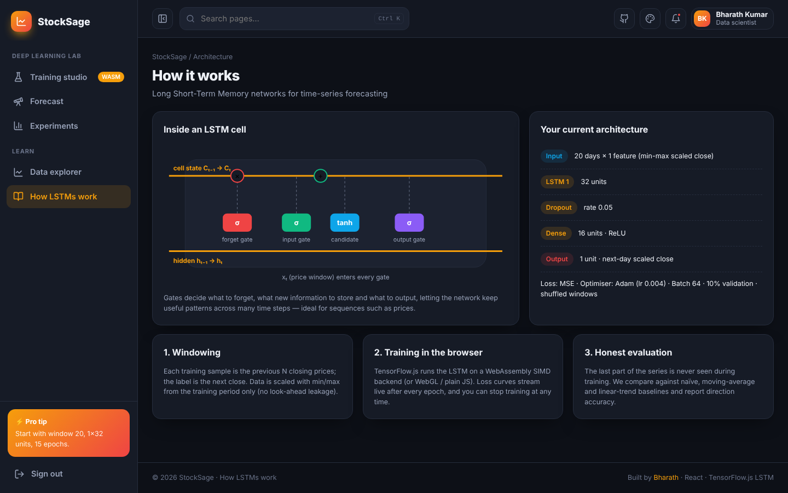

<div align="center">

# 📈 StockSage — LSTM Stock Price Forecasting (TensorFlow.js)

**A deep-learning lab that trains a Long Short-Term Memory network on stock price history directly in your browser — tune hyper-parameters, watch loss curves live, benchmark against baselines, track experiments and forecast with uncertainty bands.**

[](https://preciousbharath.github.io/STOCKSAGE-LSTM-STOCK-FORECASTING/)


### 🔗 [preciousbharath.github.io/STOCKSAGE-LSTM-STOCK-FORECASTING](https://preciousbharath.github.io/STOCKSAGE-LSTM-STOCK-FORECASTING/)
Demo login → **demo@stocksage.app** / **Demo@1234**

</div>

---

## ✨ Features

| Page | What it does |
|---|---|
| 🔐 **Register / login** | Animated auth, roles, hashed passwords, demo account |
| 🧪 **Training studio** | Pick a dataset or **upload any Date/Close CSV** (NSE, Yahoo…), tune look-back window, LSTM units, stacked layers, epochs, learning rate, dropout and train split → train with the **WebAssembly SIMD** backend (or WebGL GPU / plain JS — selectable) with a live train/validation loss chart, progress bar, ETA and stop button |
| 🎯 **Honest evaluation** | Held-out test period, one-step-ahead predictions vs actual, RMSE / MAE / MAPE / direction accuracy, compared with naïve, 5-day SMA and 10-day linear-trend baselines |
| 🔭 **Forecast** | Recursive 5/10/20/40-day forecast with a 95 % band that widens with √horizon, bullish/bearish bias, forecast table |
| 🧾 **Experiment tracker** | Every run logged (dataset, hyper-parameters, params, RMSE, MAPE, direction, time); best run highlighted; size-vs-error bubble chart |
| 📊 **Data explorer** | Price with SMA 20/50 and Bollinger bands, total return, CAGR, annualised volatility, max drawdown, return distribution, drawdown chart |
| 📚 **How LSTMs work** | Illustrated LSTM cell (forget / input / output gates), your live architecture, explanation of windowing & leakage-free scaling |
| 🎨 **Themes** | Dark (default) + 4 more themes, 6 accents, animation toggle |

## 🧠 Model

```
input  : [window × 1] min-max scaled closes (scaler fitted on the training period only)
LSTM   : 1–3 stacked layers × 8–96 units (glorot recurrent init)
Dropout: 0–0.4
Dense  : 16 · ReLU  →  Dense 1 (next-day scaled close)
loss   : MSE · Adam · batch 64 · 10 % validation · shuffled windows
```

Sample run (TechNova synthetic series, window 20, 1×LSTM(32), 15 epochs, WASM backend): **4,897 parameters, trains in ≈15 s, MAPE ≈ 2–2.5 %, direction accuracy ≈ 51–53 %** on 150 unseen days (varies run to run).

> 📌 Built-in datasets are **synthetic** (geometric Brownian motion with regimes, seasonality and jumps) so the demo works offline. Upload a real CSV to experiment with real markets. Markets are close to a random walk, so the naïve baseline is hard to beat — this is an ML learning project, **not investment advice**.

## 🖼️ Screenshots

| Training studio | Forecast |
|---|---|
|  |  |
| **Data explorer** | **How LSTMs work** |
|  |  |

## 🚀 Run locally

```bash
git clone https://github.com/PreciousBharath/STOCKSAGE-LSTM-STOCK-FORECASTING.git
cd STOCKSAGE-LSTM-STOCK-FORECASTING
npm install && npm run dev
```

## 📁 Structure

```
src/lib/data.js    # synthetic series generator, CSV parser, SMA, metrics
src/lib/lstm.jsx   # TensorFlow.js backends (WASM/WebGL/CPU), model building, training loop, evaluation, forecast
public/tfjs/       # self-hosted WebAssembly binaries for the tfjs-backend-wasm
src/pages/         # Studio, Forecast, Runs, Explorer, HowItWorks
```

## 👨‍💻 Author

**Bharath** — AI/ML & Deep Learning Trainer · Software Developer · Madurai  
[GitHub](https://github.com/PreciousBharath) · [LinkedIn](https://linkedin.com/in/connectbharath) · [Portfolio](https://itsbharathportfolio.netlify.app)
